# Loja Max — plataforma de vendas de roupas, calçados e bijuterias

Plataforma **multi-loja** com **API Spring** e **app Flutter**, no mesmo padrão do [Gerenciamento Max](https://github.com/Agsterr/Gerenciamento_Max):
cada lojista abre a loja pelo app, o cliente tem **uma conta para todas as lojas**, e os dados de cada loja ficam
isolados (`tenant_id` filtrado pelo Hibernate). Avisos iguais aos do Gerenciamento (sino + push do Firebase com fila,
novas tentativas e confirmação), fotos no **Cloudflare R2** e segurança reforçada (2 etapas, auditoria, bloqueios na hora).

| | |
|---|---|
| **API** (`backend/`) | Java 21 · Spring Boot 3.5 · Spring Security (JWT HS256) · JPA/Hibernate (multi-tenant) · Flyway · PostgreSQL |
| **Apps** (`mobile/`) | Flutter · **Loja Max** (cliente) e **Loja Max Lojista** (gestão da loja e admin da plataforma), com pacote comum — veja [mobile/](mobile/README.md) |

## Telas

**Loja Max (cliente)**

| | | |
|---|---|---|
| 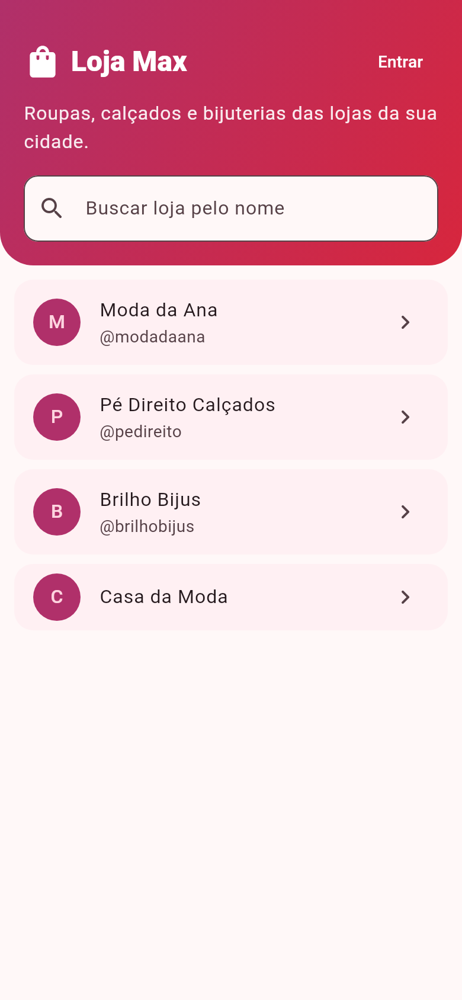 | 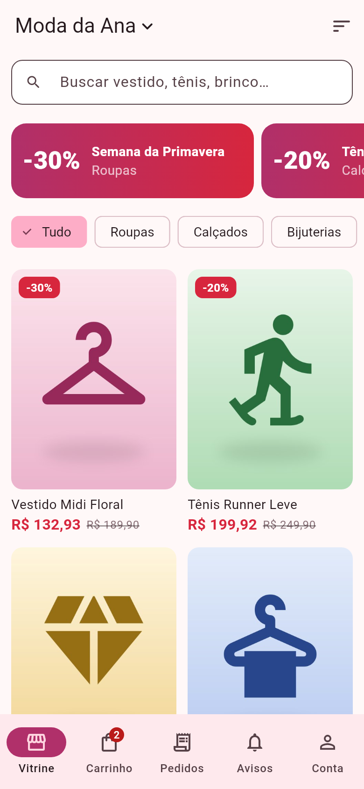 | 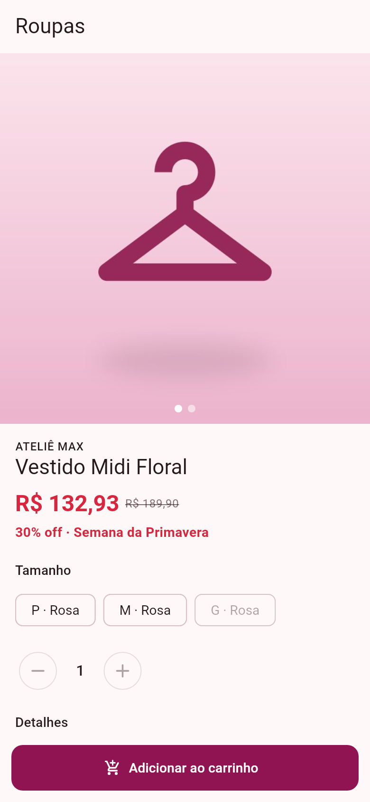 |
| 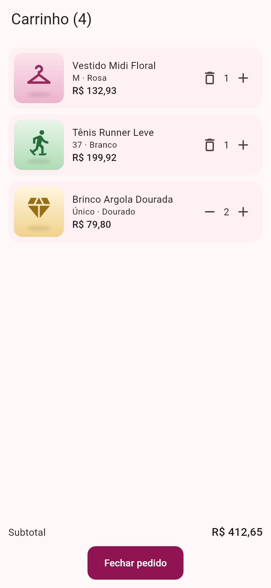 | 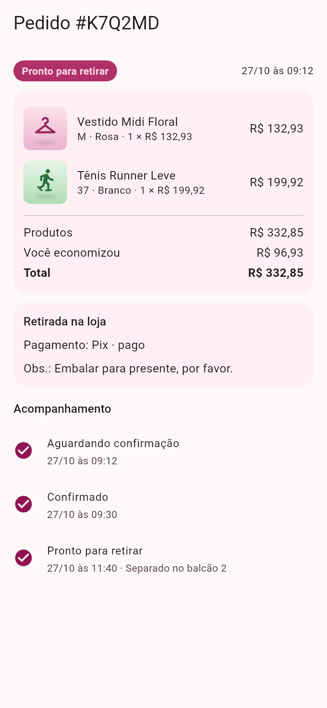 | 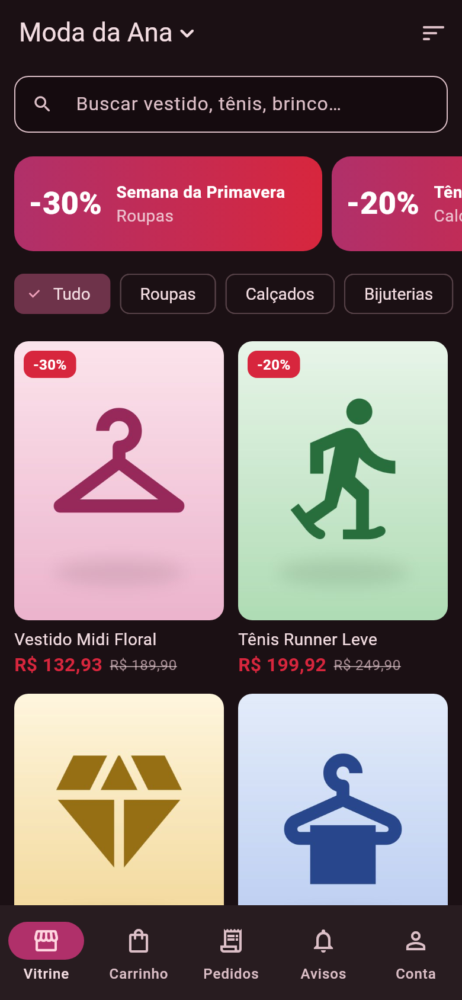 |

**Loja Max Lojista**

| | | |
|---|---|---|
| 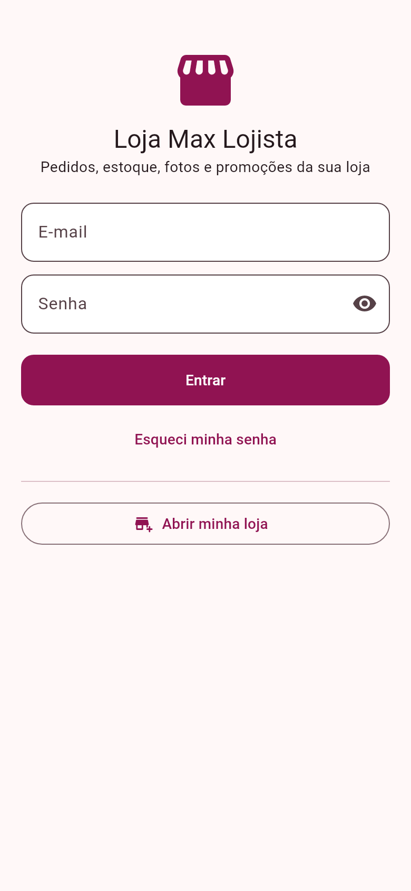 | 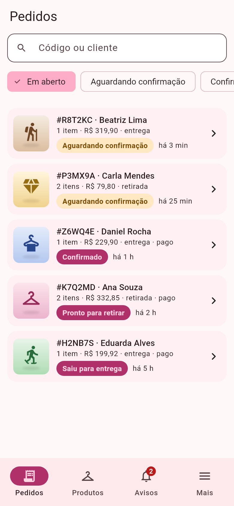 | 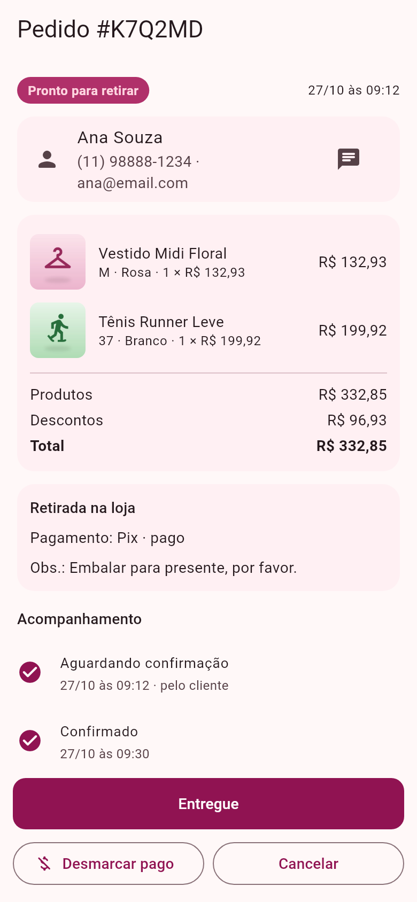 |
| 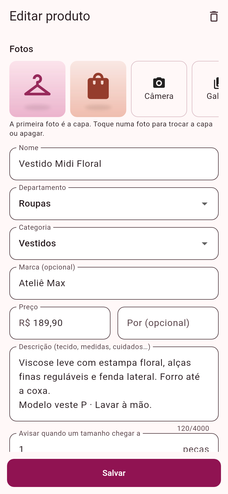 | 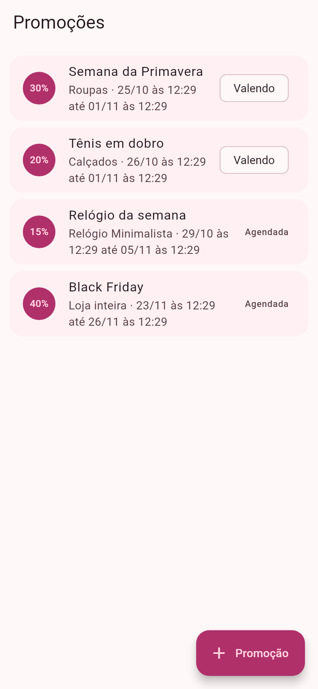 | 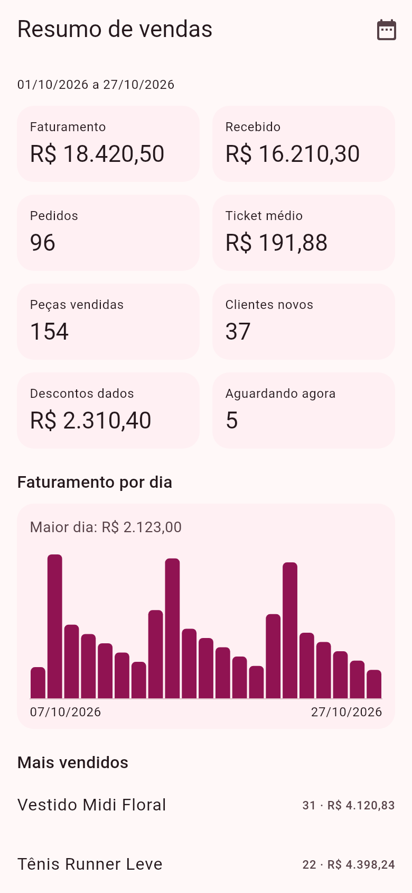 |

Geradas pelo próprio Flutter com dados de exemplo: `cd mobile/telas && flutter test telas_test.dart`
(as fotos dos produtos ali são ilustrações; no app real são as fotos que a loja envia).

## Funcionalidades

**Cliente**
- Busca a loja (ou abre direto no app de uma loja só — `--dart-define=STORE_SLUG=...`).
- Vitrine por departamento (**Roupas, Calçados, Bijuterias**), categorias, busca, ordenação e filtro de promoções — sem precisar de conta.
- Produto com fotos, preço "de/por", **tamanho/cor com estoque próprio** e **"Avise-me quando chegar"**.
- Carrinho guardado no celular (de uma loja por vez); **retirada** ou **entrega** (taxa e frete grátis a partir de X); pagamento Pix/cartão/dinheiro.
- Pedido com linha do tempo; cancelar enquanto a loja não separou.
- Avisos de todas as lojas em que comprou; promoções das lojas que segue.
- Conta: dados, senha, **verificação em duas etapas**, **acessos da conta**, sair de todos os aparelhos, excluir conta.

**Lojista (app Loja Max Lojista)**
- Lojista abre a loja pelo app ("Abrir minha loja") e vira o dono; cadastra funcionários, que entram pelo mesmo app.
- Pedidos em aberto/por status, avançar status, marcar pago, WhatsApp do cliente.
- Produtos com tamanhos/cores, **fotos pela câmera/galeria** (R2), entrada/contagem/perda de estoque com histórico paginado.
- Promoções por período — loja inteira, departamento, categoria ou **um produto só** — com **push para os clientes quando começa**.
- Dono: resumo de vendas (faturamento, recebido, ticket médio, clientes novos, descontos, gráfico por dia, mais vendidos,
  estoque baixo), equipe, dados da loja, **bloqueio de cliente só na loja dele** e **auditoria**.

**Administrador da plataforma** (entra pelo app do lojista): lista lojas e contas, bloqueia/desbloqueia (vale na hora) e desliga a verificação em
duas etapas de quem perdeu o celular.

## Multi-loja (multi-tenant)
- Banco compartilhado com **coluna `tenant_id`** em catálogo, estoque, fotos, pedidos e promoções. As entidades estendem
  `TenantEntity` (`@TenantId`): o Hibernate **filtra e preenche a loja em toda consulta** — não dá para esquecer o `where`.
- A loja da requisição vem do claim `tenant` do JWT (equipe) ou do endereço na URL `/api/public/stores/{slug}` e
  `/api/stores/{slug}` (cliente). Loja bloqueada some da vitrine e a equipe dela é barrada.
- Consultas em SQL puro (relatório, clientes, auditoria) filtram `tenant_id` explicitamente.
- Teste `storesNeverSeeEachOthersData`: a loja B não lê nem altera produto, pedido, estoque, avisos ou clientes da A.

## Eventos e avisos (igual ao Gerenciamento Max)

Os serviços publicam eventos (`event/StoreEvents`); um ouvinte na **mesma transação** grava o aviso do sino e coloca o
push na fila (`push_outbox`). O worker entrega pelo Firebase (FCM HTTP v1) com novas tentativas (1 min, 5 min, 30 min,
2 h) e o app confirma o recebimento. Sem Firebase, o app confere o sino em segundo plano. Detalhes em [docs/PUSH.md](docs/PUSH.md).

| Evento | Quem recebe |
|---|---|
| Pedido novo | equipe da loja (e "pedido recebido" para o cliente) |
| Cliente cancelou | equipe da loja |
| Tamanho/cor no estoque mínimo ou esgotado | equipe da loja |
| Pedido confirmado / pronto / saiu / entregue / cancelado pela loja | cliente |
| Pagamento confirmado | cliente |
| Tamanho esgotado voltou ao estoque | clientes que pediram "avise-me" |
| Promoção começou | celulares que seguem a loja e aceitam promoções (com ou sem login) |

## Rodando

```bash
docker compose up --build            # banco + API em http://localhost:8080 (cria o admin da plataforma)

cd mobile/cliente && flutter pub get && flutter run --dart-define=API_URL=http://10.0.2.2:8080   # ou mobile/lojista
```

### Testes
```bash
createdb -O loja loja_test
cd backend && mvn test           # TEST_DB_URL, DB_USER e DB_PASSWORD são configuráveis
cd mobile && for d in core cliente lojista telas; do (cd $d && flutter analyze); done; (cd cliente && flutter test); (cd lojista && flutter test)
```
No GitHub: CI (API com PostgreSQL, os dois apps e os dois APKs), **CodeQL** (análise de segurança do código) e **Dependabot** (atualizações).

## Arquitetura

```
backend/src/main/java/com/max/loja
├── shared/        tenant (TenantContext, @TenantId), erros (ProblemDetail), paginação, limite de tentativas
├── security/      JWT, filtros de status da conta e de tenant, TOTP, cifra de segredos, auditoria
├── auth/          cadastro (cliente e loja), login com trava e 2 etapas, senha, equipe, exclusão de conta
├── store/         lojas (o tenant), busca de lojas, dados da loja, tenant pelo endereço na URL
├── platform/      administração da plataforma (lojas e contas)
├── catalog/       departamentos, categorias, produtos, tamanhos/cores, estoque
├── media/         fotos: compressão (ImageIO) + Cloudflare R2 (assinatura S3 V4) ou disco
├── promotion/     promoções, preço final e aviso quando começam
├── order/         pedidos, itens, linha do tempo
├── event/         eventos da loja
├── notification/  sino + ouvinte dos eventos + "avise-me"
├── push/          dispositivos, lojas seguidas, fila de push, worker e envio pelo FCM
└── report/        resumo de vendas (agregado no PostgreSQL)
```

### Principais endpoints
| Método | Rota | Quem |
|---|---|---|
| POST | `/api/auth/register` (cliente) · `/register-store` (lojista) · `/login` (`code` com 2 etapas) · `/forgot-password` · `/reset-password` | público |
| GET | `/api/public/stores?q=` · `/api/public/stores/{slug}` · `/categories` · `/products?department=&categoryId=&q=&onSale=&sort=&page=` · `/products/{id}` · `/promotions` | público |
| POST | `/api/public/stores/{slug}/push` (celular segue a loja) · `/api/push/ack` | público |
| GET · PUT · POST | `/api/me` · `/token` · `/password` · `/logout-all` · `/delete` · `/2fa/setup·enable·disable` · `/security-events` · `/push-token` · `/watches/{productId}` | logado |
| GET · POST | `/api/notifications?page=` · `/read` · `/{id}/read` | logado |
| POST · GET | `/api/stores/{slug}/orders` · `/{id}` · `/{id}/cancel` | cliente |
| GET · POST · PUT · DELETE | `/api/store/products[/{id}]` · `/photos` · `/variants/{id}/stock?page=` · `/stock/low` · `/categories` · `/orders` · `/customers` | equipe |
| GET · POST · PUT | `/api/store/promotions` · `/reports/summary` · `/users` · `/settings` · `/audit` · bloquear cliente | dono |
| GET · POST | `/api/platform/stores` · `/stores/{id}/block·unblock` · `/users` · `/users/{id}/block·unblock·reset-2fa` | admin da plataforma |

Listas que crescem são paginadas (`page`, `size` até 100; resposta com `items`, `total` e `hasMore`): vitrine, busca de
lojas, produtos, pedidos, clientes, sino, histórico de estoque, auditoria e as listas da plataforma.

## Segurança
Resumo em [docs/SEGURANCA.md](docs/SEGURANCA.md).

## Variáveis de ambiente (API)
Veja [.env.example](.env.example): `DB_*`, `JWT_SECRET` (≥ 32), `APP_ENCRYPTION_KEY`, `PLATFORM_ADMIN_EMAIL`/`PASSWORD`,
`APP_PUBLIC_URL`, `CORS_ORIGINS`, `R2_*` ([docs/FOTOS_R2.md](docs/FOTOS_R2.md)),
`FIREBASE_SERVICE_ACCOUNT_JSON_BASE64` ([docs/PUSH.md](docs/PUSH.md)), `RESEND_API_KEY`/`MAIL_FROM`, `APP_TIMEZONE`.
